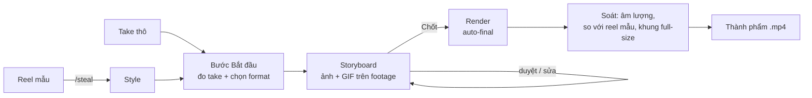

# Video Agent

> Quy trình dựng video ngắn (9:16) bằng Claude Code: học style từ một reel mẫu, lên storyboard trên chính cảnh quay, duyệt rồi mới render. Chạy hoàn toàn trên máy, không cần dịch vụ trả phí.


---

## Mục lục

- [Tính năng](#tính-năng)
- [Quy trình](#quy-trình)
- [Cấu trúc thư mục](#cấu-trúc-thư-mục)
- [Cài đặt](#cài-đặt)
- [Sử dụng nhanh](#sử-dụng-nhanh)
- [Cổng storyboard](#cổng-storyboard)
- [Nguyên tắc dựng](#nguyên-tắc-dựng)
- [Dữ liệu local và Git](#dữ-liệu-local-và-git)

---

## Tính năng

| | |
|---|---|
| **Học style từ reel mẫu** | Đo nhịp cắt, cỡ mặt, zoom, chữ, nhạc và hiệu ứng âm thanh của một reel rồi lưu thành style dùng lại (`/steal`). |
| **Cổng storyboard** | Phân tích take, đề xuất format, dựng trang duyệt với ảnh xem trước và **GIF động trên footage thật** cho từng đoạn. |
| **Biến thể trong cùng style** | Mỗi style có 2–3 biến thể màu/font; đổi biến thể là ảnh xem trước tự vẽ lại theo đúng biến thể đó. |
| **Lưới an toàn khi render** | Bấm *Chốt* là thành phẩm tự dựng trong tiến trình riêng (`auto-final.mjs`); phiên làm việc dừng giữa chừng vẫn có video. |
| **Soát chất lượng** | Kiểm tra cỡ chữ, chồng chữ, vùng an toàn, độ lớn từng đoạn (−14 ±1 LUFS, đỉnh ≤ −1 dBTP) trước khi giao. |

## Quy trình



1. **Bắt đầu** – đo take thật (tỉ lệ có mặt người, giọng, nhịp, quay màn hình), kiểm tra đầu vào, đề xuất 1 format chính + 1 dự phòng.
2. **Storyboard** – mỗi đoạn có thẻ hiệu ứng gắn đúng câu nói, ảnh xem trước và GIF; chọn biến thể màu/font, âm thanh, chuyển động, ảnh bìa.
3. **Chốt** – ghi `choices.json`, tự dựng thành phẩm.
4. **Soát** – render từng đoạn, so với ảnh xem trước, đo âm lượng, so với reel mẫu, rồi mới giao.

## Cấu trúc thư mục

```text
.
├── CLAUDE.md                          # quy tắc dự án cho Claude Code (cổng storyboard bật mặc định)
├── .claude/skills/storyboard-gate/
│   ├── SKILL.md                       # hướng dẫn đầy đủ của cổng storyboard
│   ├── scripts/
│   │   ├── start.mjs                  # bước Bắt đầu: đo take, đề xuất format
│   │   ├── preview.mjs                # ảnh xem trước + mẫu âm thanh + ảnh bìa
│   │   ├── gif.mjs                    # GIF động từng đoạn trên footage thật
│   │   ├── build-wizard.mjs           # dựng trang duyệt
│   │   ├── server.mjs                 # trang duyệt local (http://127.0.0.1:4747)
│   │   ├── cardspec.mjs               # 1 spec cho cả ảnh xem trước lẫn render
│   │   ├── render-seg.mjs             # render từng đoạn, có checkpoint
│   │   ├── auto-final.mjs             # tự dựng thành phẩm sau khi Chốt
│   │   └── qc.mjs · seg-gain.mjs · compare.py · …
│   └── wizard/index.html
└── video-agent/
    ├── formats/                       # ROUTER.md + hồ sơ từng format (talking-head, faceless-broll, animation-story)
    └── storyboards/templates/         # template dùng lại cho các take cùng nguồn
```

Thư mục local (không có trên GitHub): `styles/`, `takes/`, `edits/`, `inputs/`, `presets/`, `backups/`.

## Cài đặt

**Yêu cầu:** [Claude Code](https://claude.com/claude-code), Node.js 20+, ffmpeg, yt-dlp, Python 3 (cho `compare.py`).

```bash
git clone https://github.com/NamHocAI/video-agent.git
cd video-agent
```

Engine dựng (`short-editing`) và các skill toàn cục nằm trong `~/.claude/skills/`. Lần đầu chạy `/studio-setup` để cài công cụ còn thiếu.

## Sử dụng nhanh

```text
/steal <link reel mẫu>                       # học style mới
/short-editing <take> style <tên-style>      # dựng 1 video (cổng storyboard tự chạy trước)
```

Chạy tay từng bước (từ thư mục `video-agent/`):

```bash
node ../.claude/skills/storyboard-gate/scripts/start.mjs takes/<take>.mp4 --style <tên-style>
node ../.claude/skills/storyboard-gate/scripts/preview.mjs edits/short-<slug>/storyboard/plan.json
node ../.claude/skills/storyboard-gate/scripts/gif.mjs edits/short-<slug>/storyboard/plan.json
node ../.claude/skills/storyboard-gate/scripts/build-wizard.mjs edits/short-<slug>/storyboard/plan.json
node ../.claude/skills/storyboard-gate/scripts/server.mjs edits/short-<slug>/storyboard --port 4747
```

Dựng lại thành phẩm khi cần (sau khi đã Chốt):

```bash
node ../.claude/skills/storyboard-gate/scripts/auto-final.mjs edits/short-<slug>/storyboard
```

## Cổng storyboard

- Bật **mặc định** trước mọi lần dựng take mới; chỉ bỏ qua cho đúng 1 video khi người dùng nói rõ (ghi `storyboards/<slug>/SKIP.md`).
- Kịch bản và B-roll **không bắt buộc**; thiếu video thô hoặc style thì dừng và báo.
- Chỉ xuất video sau khi bấm **Chốt & dựng thành phẩm** (hoặc gửi mã `SB1-…`).
- Chi tiết: [`SKILL.md`](.claude/skills/storyboard-gate/SKILL.md).

## Nguyên tắc dựng

- **Chữ theo lời nói thật**, từ nhấn hiện đúng lúc được nói; lời chỉ hướng ("dưới đây") thì chữ/hình theo đúng hướng.
- **Ảnh thật, đúng ngữ cảnh** cho đồ vật được nhắc mà take không có, làm sticker cùng kiểu với style.
- **Chuyển động sáng tạo theo take**, mỗi đoạn một hành động chính, không dùng preset chung.
- **Nhìn là biết style**: đúng font, bảng màu, cách hiện chữ của style.
- **Tự soát trước khi đưa duyệt**: không tràn mép, không che mặt, trang trí không đè chữ.

## Dữ liệu local và Git

Repo chỉ chứa **mã nguồn và tài liệu**. `.gitignore` loại `.env`, take thô, media (video, ảnh, nhạc, font), bản render, storyboard đang làm, style và preset cá nhân. Không commit secrets, media nguồn hoặc output render.
